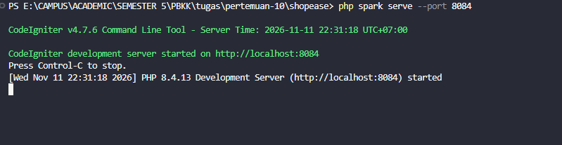
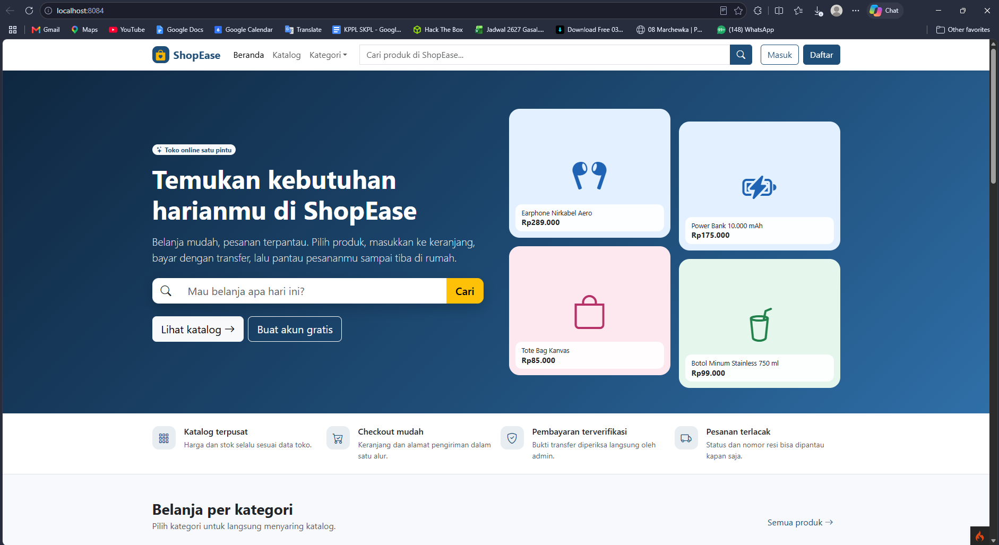

# Pertemuan 10 · Landing Page ShopEase (CodeIgniter 4)

| Identitas | |
|---|---|
| Nama | Puspita Wijayanti Kusuma |
| NRP | 5025241059 |
| Kelas | PBKK C |

Landing page toko online **ShopEase** berdasarkan `PRD_ShopEase_CodeIgniter4` (bagian 10 Spesifikasi Halaman: Homepage, Katalog, Detail Produk, Login/Register). Tugas ini memodifikasi **routing**, **controller**, dan **view** pada CodeIgniter 4.

## Run Aplikasi

```bash
cd shopease
composer install
cp .env.example .env
php spark serve --port 8084
```

Buka `http://localhost:8084/`.



*Server pengembangan CodeIgniter dijalankan pada port 8084.*

## Routing (`app/Config/Routes.php`)

| Method | URL | Nama rute | Handler | Halaman PRD |
|---|---|---|---|---|
| GET | `/` | `home` | `HomeController::index` | Homepage |
| GET | `/products?q=&category=&sort=&page=` | `products` | `ProductController::index` | Katalog |
| GET | `/products/{slug}` | `product.show` | `ProductController::show` | Detail Produk |
| GET | `/category/{slug}` | `category` | `ProductController::category` (redirect ke katalog terfilter) | Kategori |
| GET | `/login`, `/register` | `login`, `register` | `AuthController` | Login/Register |

Semua tautan pada view dibuat dengan `url_to('<nama rute>')`, sehingga URL cukup diubah di satu tempat.

## Controller

- `HomeController` mengirim kategori, produk unggulan, dan produk terbaru ke view landing page.
- `ProductController` menangani pencarian nama, filter kategori, pengurutan (terbaru, harga, nama), dan pagination. Produk yang tidak ditemukan atau berstatus nonaktif menghasilkan 404 (BR-002).
- `AuthController` menampilkan form login dan registrasi. Proses autentikasi dijadwalkan pada milestone M2.
- Data produk dan kategori diambil dari `app/Libraries/Catalog.php`. Struktur datanya mengikuti tabel `categories` dan `products` pada PRD bagian 11.

## View

```
app/Views/
├── layouts/main.php            # kerangka HTML, Bootstrap 5 lokal
├── partials/navbar.php         # logo, navigasi, dropdown kategori, search, tombol Masuk/Daftar
├── partials/footer.php
├── frontend/home.php           # banner, keunggulan, kategori, produk unggulan, cara belanja, produk terbaru
├── frontend/products/index.php # katalog + filter + pagination
├── frontend/products/show.php  # detail produk + produk terkait
├── frontend/products/_card.php # kartu produk
├── auth/login.php, auth/register.php
└── pagers/bootstrap.php
```

## Tampilan Halaman

### Landing Page



*Header berisi logo, menu, dropdown kategori, kolom pencarian, serta tombol Masuk dan Daftar. Banner menampilkan kolom pencarian dan empat produk unggulan, diikuti empat keunggulan layanan.*


*Bagian kategori menampilkan enam kategori beserta jumlah produknya. Setiap kartu mengarah ke katalog yang sudah difilter. Di bawahnya ditampilkan produk unggulan.*


*Empat langkah cara belanja sesuai alur customer di PRD, lalu daftar produk terbaru. Produk dengan stok kurang dari 10 diberi label "Sisa".*


*Ajakan untuk mendaftar dan footer berisi tautan belanja, akun, serta kontak toko.*

### Katalog per Kategori


*Katalog kategori Fashion dengan panel filter (kata kunci, kategori, urutan) dan pagination.*


*Katalog kategori Kecantikan, dibuka dari dropdown Kategori di navbar.*

### Detail Produk


*Detail produk berisi nama, harga, stok, deskripsi, dan jumlah pembelian, serta produk lain dari kategori yang sama.*

### Login dan Registrasi


*Form login dengan email dan password.*


*Form registrasi customer dengan nama, email, password, dan konfirmasi password.*
