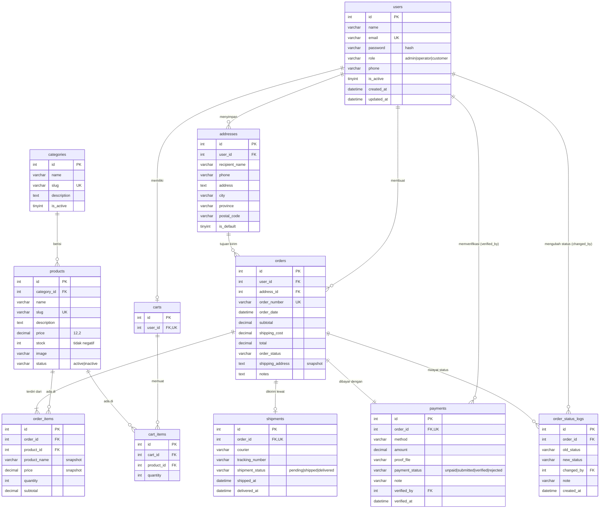

# ERD ShopEase (db_shopease)

Diagram di bawah ditulis dengan Mermaid (tampil otomatis di GitHub/VS Code dengan ekstensi Mermaid).
Dapat diekspor ke PNG/PDF melalui https://mermaid.live untuk dikumpulkan sebagai deliverable ERD.

Catatan desain:
- `order_items.product_name` dan `price` adalah **snapshot** agar riwayat tidak berubah saat katalog diperbarui.
- `orders.shipping_address` adalah salinan alamat saat transaksi (alamat master boleh diubah/dihapus).
- Status pesanan (`orders.order_status`) dan status pembayaran (`payments.payment_status`) dipisah.
- Foreign key `order_items.product_id → products` bersifat `RESTRICT`: produk yang sudah dipesan tidak bisa dihapus (dinonaktifkan saja).
