# Pertemuan 9 · CodeIgniter 4: LabLend, SIAKAD, dan Kopi Nusantara

| Identitas | |
|---|---|
| Nama | Puspita Wijayanti Kusuma |
| NRP | 5025241059 |
| Kelas | PBKK C |
| Mata kuliah | Pemrograman Berbasis Kerangka Kerja (PBKK) |


Tugas ini terdiri atas tiga aplikasi web yang dibangun menggunakan CodeIgniter 4. Latihan 1 memiliki tema bebas, dan tema yang dipilih adalah peminjaman alat laboratorium. Latihan 2 mengikuti topik yang ditetapkan dosen, yaitu sistem informasi akademik dan toko online.

CodeIgniter merupakan framework PHP yang ringan dan menerapkan pola **Model-View-Controller** (MVC). *Model* menangani tabel basis data beserta validasinya, *View* memuat tampilan HTML yang dapat disusun dari layout dan partial, sedangkan *Controller* berperan sebagai penghubung yang menerima request, kemudian menentukan model dan view yang digunakan. Alur sebuah request pada CI4 adalah sebagai berikut: `public/index.php` → router (`app/Config/Routes.php`) → filter sebelum (CSRF, `auth`, `role`) → controller → model/service → view → respons.

## Isi Repositori

```
pertemuan-9/
├── README.md
├── docs/
│   ├── latihan1/
│   ├── latihan2a/
│   └── latihan2b/
├── latihan1/
├── latihan2a/
└── latihan2b/
```

| Folder | Aplikasi | Port | Database | Gambar dokumentasi |
|---|---|---|---|---|
| `latihan1/` | LabLend, peminjaman alat laboratorium | 8081 | `ci4_lablend` | `docs/latihan1/` |
| `latihan2a/` | SIAKAD, sistem informasi akademik | 8082 | `ci4_siakad` | `docs/latihan2a/` |
| `latihan2b/` | Kopi Nusantara, toko biji kopi lokal | 8083 | `ci4_kopinusantara` | `docs/latihan2b/` |

Ketiga aplikasi menggunakan port dan basis data yang berbeda sehingga dapat dijalankan secara bersamaan. Setiap aplikasi memiliki struktur yang seragam: `app/Config/Routes.php`, `app/Controllers` (dengan subfolder per peran), `app/Models`, `app/Services`, `app/Filters` (`AuthFilter`, `RoleFilter`), `app/Database/{Migrations,Seeds}`, `app/Views/{layouts,partials,...}`, `public/assets`, dan `public/uploads`.

## Spesifikasi

| Komponen | Versi |
|---|---|
| CodeIgniter | 4.7.6 |
| PHP | 8.4.13 (intl, mbstring, mysqli, fileinfo, gd) |
| Composer | 2.8.12 |
| Database | MariaDB 10.4.32 dari XAMPP (kompatibel MySQL) |
| Bootstrap untuk halaman publik | 5.3.8 dan Bootstrap Icons 1.13.1 |
| Template panel | SB Admin 2 4.1.4 (Bootstrap 4.6.0, Font Awesome 5.15.3, jQuery 3.6.0, Chart.js 2.9.4) |

Seluruh berkas CSS dan JavaScript disimpan secara lokal di `public/assets/` sehingga aplikasi tidak bergantung pada CDN.

## Run Aplikasi

Langkah berikut merupakan contoh untuk `latihan1`. Untuk `latihan2a` dan `latihan2b`, nama folder, basis data, dan port disesuaikan dengan tabel pada bagian Isi Repositori.

```bash
cd latihan1
composer install
cp .env.example .env
php spark db:create ci4_lablend
php spark migrate && php spark db:seed DatabaseSeeder
php spark serve --port 8081
```

File `.env` berisi pengaturan berikut.

```ini
CI_ENVIRONMENT = development
app.baseURL = 'http://localhost:8081/'
app.indexPage = ''
app.appTimezone = 'Asia/Jakarta'
database.default.hostname = localhost
database.default.database = ci4_lablend
database.default.username = root
database.default.password =
database.default.DBDriver = MySQLi
session.cookieName = 'lablend_session'
security.csrfProtection = 'session'
security.tokenName = 'csrf_token'
```


## Latihan 1

Latihan 1 berupa aplikasi LabLend, yaitu sistem peminjaman alat pada Laboratorium Terpadu. Pengunjung dapat melihat katalog alat tanpa login. Mahasiswa (`borrower`) mengajukan peminjaman, sedangkan laboran (`admin`) mengelola inventaris dan memproses pengajuan.

**Akun demo**

| Peran | Halaman masuk | Username | Password |
|---|---|---|---|
| Laboran | `/admin/login` | `admin`, `laboran2` | `admin123` |
| Mahasiswa | `/login` | `5025231001` sampai `5025231012` | `mahasiswa123` |

**Struktur data**

| Tabel | Isi |
|---|---|
| `users` | `name`, `username` unik, `password` hash, `role` (`admin` / `borrower`) |
| `categories` | `name` unik |
| `tools` | `name`, `slug` unik, `category_id`, `stock`, `condition` (`good` / `fair` / `damaged`), `photo`, `description` |
| `loans` | `user_id`, `tool_id`, `quantity`, `borrow_date`, `return_date`, `returned_at`, `status` (`pending` / `approved` / `borrowed` / `returned` / `rejected`), `note` |
| `messages` | pesan dari formulir kontak: `name`, `email`, `subject`, `body` |

Seeder mengisi 14 data pengguna, 10 kategori, 20 alat, 15 peminjaman yang tersebar dalam enam bulan terakhir, dan 10 pesan kontak. Setiap alat dilengkapi foto yang bersumber dari Wikimedia Commons. Berkas foto disimpan di `app/Database/Seeds/images/` dan disalin ke `public/uploads/tools/` ketika seeder dijalankan, sedangkan judul, lisensi, dan tautan sumber setiap foto dicatat pada `app/Database/Seeds/images/SUMBER.txt`.

### 1. Instalasi dan Konfigurasi CI

Aplikasi dipasang menggunakan perintah `composer create-project codeigniter4/appstarter latihan1`, kemudian dikonfigurasi melalui berkas `.env` (base URL, basis data, zona waktu Asia/Jakarta, serta `app.indexPage` yang dikosongkan agar URL tidak memuat `index.php`). Seluruh tabel dibuat menggunakan migration dan diisi menggunakan seeder, tidak melalui phpMyAdmin.

Halaman welcome bawaan diganti dengan halaman `/welcome` yang menampilkan biodata, versi CodeIgniter dan PHP, basis data yang sedang terhubung, serta penjelasan isi folder `app/`, `public/`, `writable/`, `vendor/`, dan `tests/`. Biodata dibaca dari berkas konfigurasi `app/Config/Site.php`. Nilai biodata dapat diisi langsung pada berkas tersebut atau melalui `.env` dengan kunci `site.studentName`, `site.studentNumber`, dan `site.className`.

```php
class Site extends BaseConfig
{
    public string $appName = 'LabLend';
    public string $studentName = '';
    public string $studentNumber = '';
    public string $className = '';
    public string $courseName = 'Pemrograman Berbasis Kerangka Kerja';
}
```

```php
public function index(): string
{
    $site = config(Site::class);

    return view('welcome/index', [
        'title'   => 'Selamat Datang',
        'site'    => $site,
        'biodata' => [
            'Nama'        => $site->studentName,
            'NRP'         => $site->studentNumber,
            'Kelas'       => $site->className,
            'Mata Kuliah' => $site->courseName,
        ],
        'runtime' => [
            'Versi CodeIgniter' => CodeIgniter::CI_VERSION,
            'Versi PHP'         => PHP_VERSION,
            'Zona Waktu'        => app_timezone(),
            'Database'          => db_connect()->getDatabase(),
        ],
    ]);
}
```

Berikut migration tabel `tools`, termasuk foreign key ke tabel `categories`:

```php
$this->forge->addField([
    'id'          => ['type' => 'INT', 'unsigned' => true, 'auto_increment' => true],
    'category_id' => ['type' => 'INT', 'unsigned' => true],
    'name'        => ['type' => 'VARCHAR', 'constraint' => 120],
    'slug'        => ['type' => 'VARCHAR', 'constraint' => 140],
    'stock'       => ['type' => 'INT', 'unsigned' => true, 'default' => 0],
    'condition'   => ['type' => 'ENUM', 'constraint' => ['good', 'fair', 'damaged'], 'default' => 'good'],
    'photo'       => ['type' => 'VARCHAR', 'constraint' => 255, 'null' => true],
    'description' => ['type' => 'TEXT', 'null' => true],
    'created_at'  => ['type' => 'DATETIME', 'null' => true],
    'updated_at'  => ['type' => 'DATETIME', 'null' => true],
]);
$this->forge->addPrimaryKey('id');
$this->forge->addUniqueKey('slug');
$this->forge->addForeignKey('category_id', 'categories', 'id', 'CASCADE', 'RESTRICT');
$this->forge->createTable('tools');
```

### 2. Fungsi Router dan Controller

Auto routing dibiarkan nonaktif sehingga setiap URL didaftarkan secara eksplisit di `app/Config/Routes.php`. Halaman beranda, about, dan contact masing-masing memiliki controller dan method tersendiri. Detail alat diakses melalui slug, sedangkan area laboran dan mahasiswa dikelompokkan menggunakan `group()` yang dilindungi filter.

```php
$routes->get('/', 'HomeController::index');
$routes->get('welcome', 'WelcomeController::index');
$routes->get('about', 'PageController::about');
$routes->get('contact', 'PageController::contact');
$routes->post('contact', 'PageController::sendMessage');
$routes->get('tools', 'ToolController::index');
$routes->get('tools/(:segment)', 'ToolController::show/$1');

$routes->group('admin', ['filter' => ['auth', 'role:admin'], 'namespace' => 'App\Controllers\Admin'], static function (RouteCollection $routes): void {
    $routes->get('/', 'DashboardController::index');
    $routes->get('tools', 'ToolController::index');
    $routes->get('tools/new', 'ToolController::new');
    $routes->post('tools', 'ToolController::create');
    $routes->get('tools/(:num)/edit', 'ToolController::edit/$1');
    $routes->post('tools/(:num)', 'ToolController::update/$1');
    $routes->post('tools/(:num)/delete', 'ToolController::delete/$1');
});

$routes->group('borrower', ['filter' => ['auth', 'role:borrower'], 'namespace' => 'App\Controllers\Borrower'], static function (RouteCollection $routes): void {
    $routes->get('/', 'DashboardController::index');
    $routes->get('loans', 'LoanController::index');
    $routes->get('loans/new/(:num)', 'LoanController::new/$1');
    $routes->post('loans', 'LoanController::create');
});
```

Apabila slug tidak ditemukan di basis data, controller melempar `PageNotFoundException` sehingga server mengembalikan respons 404.

```php
public function show(string $slug): string
{
    $tool = model(ToolModel::class)->findBySlug($slug);

    if ($tool === null) {
        throw PageNotFoundException::forPageNotFound('Alat dengan alamat "' . $slug . '" tidak ditemukan.');
    }

    return view('tools/show', ['title' => $tool['name'], 'tool' => $tool]);
}
```

Perintah `php spark routes` menampilkan 41 route beserta filter yang terpasang pada masing-masing route.

### 3. Bootstrap 5 untuk View

Halaman publik menggunakan layout `layouts/public.php`. Navbar dan footer dipisahkan menjadi partial `partials/navbar.php` dan `partials/footer.php`, sedangkan pesan flash ditempatkan pada `partials/flash.php`. Setiap halaman hanya perlu mengisi section `content`.

```php
<body class="d-flex flex-column min-vh-100">
    <?= $this->include('partials/navbar') ?>
    <main class="flex-grow-1">
        <div class="container pt-4">
            <?= view('partials/flash', ['theme' => 'bootstrap5']) ?>
        </div>
        <?= $this->renderSection('content') ?>
    </main>
    <?= $this->include('partials/footer') ?>
    <script src="<?= base_url('assets/bootstrap5/js/bootstrap.bundle.min.js') ?>"></script>
</body>
```

```php
<?= $this->extend('layouts/public') ?>

<?= $this->section('content') ?>
<div class="container py-4">
    <h1 class="fw-bold mb-1">Katalog Alat</h1>
</div>
<?= $this->endSection() ?>
```

Halaman publik yang tersedia meliputi beranda (hero, statistik, kategori, dan alat terbaru), katalog (pencarian, filter kategori, dan pagination), detail alat, about, contact, serta welcome. Kartu alat dibuat sebagai partial `tools/_card.php` agar dapat digunakan kembali pada tiga halaman. Pagination menggunakan template pager Bootstrap pada `app/Views/pagers/bootstrap.php` yang didaftarkan di `Config\Pager`.

### 4. Template SB Admin 2

Aset SB Admin 2 disalin ke `public/assets/sb-admin-2/`. Panel menggunakan layout `layouts/admin.php` yang tersusun atas tiga partial, yaitu `partials/sidebar.php`, `partials/admin_navbar.php` (topbar berisi nama pengguna dan tombol keluar), dan `partials/admin_footer.php`.

```php
<div id="wrapper">
    <?= $this->include('partials/sidebar') ?>
    <div id="content-wrapper" class="d-flex flex-column">
        <div id="content">
            <?= $this->include('partials/admin_navbar') ?>
            <div class="container-fluid">
                <?= view('partials/flash', ['theme' => 'bootstrap4']) ?>
                <?= $this->renderSection('content') ?>
            </div>
        </div>
        <?= $this->include('partials/admin_footer') ?>
    </div>
</div>
```

Isi sidebar ditentukan oleh peran yang tersimpan di session. Laboran memperoleh menu Data Alat, Kategori, Peminjaman, Pengguna, dan Pesan Masuk, sedangkan mahasiswa hanya memperoleh menu Katalog Alat dan Riwayat Saya. Menu yang sedang aktif ditandai menggunakan `url_is()`.

```php
$menus = $role === 'admin'
    ? [
        ['heading' => 'Inventaris', 'items' => [
            ['url' => 'admin/tools', 'match' => 'admin/tools*', 'icon' => 'fa-toolbox', 'label' => 'Data Alat'],
            ['url' => 'admin/categories', 'match' => 'admin/categories*', 'icon' => 'fa-tags', 'label' => 'Kategori'],
        ]],
    ]
    : [
        ['heading' => 'Peminjaman', 'items' => [
            ['url' => 'tools', 'match' => 'tools*', 'icon' => 'fa-search', 'label' => 'Katalog Alat'],
            ['url' => 'borrower/loans', 'match' => 'borrower/loans*', 'icon' => 'fa-history', 'label' => 'Riwayat Saya'],
        ]],
    ];
```

Dashboard laboran memuat empat kartu statistik (jenis alat, total unit tersedia, pengajuan menunggu, dan peminjaman aktif) serta dua grafik Chart.js, yaitu jumlah pengajuan per bulan selama enam bulan terakhir dan jumlah jenis alat per kategori. Data grafik disiapkan di controller, kemudian diteruskan ke JavaScript menggunakan `json_encode`. Setiap grafik juga dilengkapi versi tabel pada bagian "Lihat sebagai tabel".

```php
'monthlyLabels' => array_map('month_label', array_keys($monthly)),
'monthlyTotals' => array_values($monthly),
'categoryNames' => array_column($categories, 'name'),
'categoryTools' => array_map('intval', array_column($categories, 'tool_count')),
```

```php
<script>
    renderBarChart('monthlyLoansChart', <?= json_encode($monthlyLabels) ?>, <?= json_encode($monthlyTotals) ?>, 'Pengajuan', false);
    renderBarChart('categoryToolsChart', <?= json_encode($categoryNames) ?>, <?= json_encode($categoryTools) ?>, 'Jenis alat', true);
</script>
```

### 5. Model dan CRUD

`ToolModel` dan `CategoryModel` mendefinisikan `allowedFields`, `useTimestamps`, serta aturan validasi dengan pesan berbahasa Indonesia. Placeholder `{id}` pada aturan `is_unique` memastikan data yang sedang diubah tidak dianggap sebagai duplikat dirinya sendiri.

```php
class ToolModel extends Model
{
    protected $table         = 'tools';
    protected $allowedFields = ['name', 'slug', 'category_id', 'stock', 'condition', 'photo', 'description'];
    protected $useTimestamps = true;

    protected $validationRules = [
        'id'          => 'permit_empty|is_natural_no_zero',
        'name'        => 'required|min_length[3]|max_length[120]',
        'slug'        => 'required|max_length[140]|is_unique[tools.slug,id,{id}]',
        'category_id' => 'required|is_natural_no_zero|is_not_unique[categories.id]',
        'stock'       => 'required|is_natural|less_than_equal_to[1000]',
        'condition'   => 'required|in_list[good,fair,damaged]',
    ];

    public function search(?string $keyword, ?int $categoryId): static
    {
        $this->withCategory();

        if ($keyword !== null && $keyword !== '') {
            $this->groupStart()->like('tools.name', $keyword)->orLike('tools.description', $keyword)->groupEnd();
        }

        if ($categoryId !== null && $categoryId > 0) {
            $this->where('tools.category_id', $categoryId);
        }

        return $this->orderBy('tools.name');
    }
}
```

```php
$tools = model(ToolModel::class)->search($keyword, $categoryId);

return view('tools/index', [
    'tools' => $tools->paginate(9),
    'pager' => $tools->pager,
]);
```

Laboran memiliki fitur CRUD lengkap untuk alat, kategori, dan pengguna, masing-masing dilengkapi pencarian dan pagination. Data yang masih digunakan tidak dapat dihapus, misalnya kategori yang masih memiliki alat atau alat yang memiliki riwayat peminjaman.

Mahasiswa dapat mengajukan peminjaman dengan batas 5 unit, tanggal pinjam paling cepat pada hari yang sama, dan lama pinjam paling lama 14 hari (batas tersebut diatur di `Config\Site`). Pengajuan yang masih berstatus `pending` dapat dibatalkan. Perpindahan status dibatasi oleh `LoanModel::TRANSITIONS`: `pending` menjadi `approved` atau `rejected`, `approved` menjadi `borrowed`, dan `borrowed` menjadi `returned`.

Perubahan stok ditangani oleh `App\Services\LoanService`. Stok dikurangi ketika pengajuan disetujui dan dikembalikan ketika alat dikembalikan, dalam satu transaksi yang sama dengan perubahan status. Pengurangan stok menggunakan syarat `stock >= quantity` sehingga stok tidak dapat bernilai negatif meskipun dua laboran menyetujui pengajuan secara bersamaan.

```php
$db = db_connect();
$db->transBegin();

try {
    if ($targetStatus === 'approved' && ! $this->tools->decreaseStock((int) $loan['tool_id'], (int) $loan['quantity'])) {
        throw new RuntimeException('Stok alat tidak mencukupi untuk menyetujui peminjaman ini.');
    }

    if ($targetStatus === 'returned') {
        $this->tools->increaseStock((int) $loan['tool_id'], (int) $loan['quantity']);
    }

    $db->table('loans')->where('id', $loanId)->where('status', $loan['status'])->update($changes);

    if ($db->affectedRows() !== 1) {
        throw new RuntimeException('Status peminjaman sudah diubah oleh proses lain. Muat ulang halaman.');
    }

    $db->transCommit();
} catch (Throwable $exception) {
    $db->transRollback();

    throw $exception;
}
```

```php
public function decreaseStock(int $toolId, int $quantity): bool
{
    $this->db->table($this->table)
        ->set('stock', 'stock - ' . $quantity, false)
        ->where('id', $toolId)
        ->where('stock >=', $quantity)
        ->update();

    return $this->db->affectedRows() === 1;
}
```

### 6. File Upload

Foto alat divalidasi dengan aturan `max_size` 2 MB, `is_image`, `mime_in` (JPEG, PNG, WEBP), dan `ext_in`. Aturan ukuran ditempatkan paling awal agar berkas yang melampaui batas `upload_max_filesize` PHP tetap memperoleh pesan "maksimal 2 MB". Foto disimpan di `public/uploads/tools/` dengan nama acak yang dihasilkan oleh `getRandomName()`.

```php
$photoRules = [
    'photo' => [
        'rules'  => 'max_size[photo,2048]|is_image[photo]|mime_in[photo,image/jpeg,image/png,image/webp]|ext_in[photo,jpg,jpeg,png,webp]',
        'errors' => [
            'max_size' => 'Ukuran foto maksimal 2 MB.',
            'is_image' => 'File foto harus berupa gambar.',
            'mime_in'  => 'Foto harus berformat JPG, PNG, atau WEBP.',
        ],
    ],
];
```

Foto lama dihapus ketika foto diganti, ketika opsi "Hapus foto saat ini" dipilih, dan ketika data alat dihapus. Apabila penyimpanan ke basis data gagal, berkas yang baru diunggah turut dihapus agar tidak menumpuk.

```php
$photoName = $this->storePhoto($this->request->getFile('photo'));
$removePhoto = $this->request->getPost('remove_photo') === '1';

if ($photoName !== null) {
    $data['photo'] = $photoName;
} elseif ($removePhoto) {
    $data['photo'] = null;
}

if (! $this->tools->update($id, $data)) {
    $this->deletePhoto($photoName);

    return $this->backWithErrors($this->tools->errors());
}

if ($photoName !== null || $removePhoto) {
    $this->deletePhoto($tool['photo']);
}
```

```php
private function storePhoto(?UploadedFile $file): ?string
{
    if ($file === null || ! $file->isValid() || $file->hasMoved()) {
        return null;
    }

    $name = $file->getRandomName();
    $file->move(self::PHOTO_DIRECTORY, $name);

    return $name;
}
```

Pratinjau foto pada formulir ditangani oleh `public/assets/js/photo-preview.js` menggunakan `URL.createObjectURL`. Skrip tersebut juga menolak berkas berukuran di atas 2 MB sebelum formulir dikirim.

### 7. Akses User

Aplikasi menyediakan dua halaman masuk, yaitu `/login` untuk mahasiswa dengan tampilan Bootstrap 5 dan `/admin/login` untuk laboran dengan tampilan login SB Admin 2. Akun mahasiswa ditolak pada halaman masuk laboran, demikian pula sebaliknya. Setelah password terverifikasi, session diregenerasi untuk mencegah *session fixation*.

```php
if ($user === null || ! password_verify((string) $this->request->getPost('password'), $user['password'])) {
    return redirect()->to($loginPath)->withInput()->with('error', 'Username atau password salah.');
}

if ($user['role'] !== $role) {
    $otherPage = $user['role'] === 'admin' ? 'halaman masuk laboran' : 'halaman masuk mahasiswa';

    return redirect()->to($loginPath)->withInput()->with('error', 'Akun ini bukan akun ' . role_label($role) . '. Silakan gunakan ' . $otherPage . '.');
}

session()->regenerate(true);
session()->set([
    'user_id'   => (int) $user['id'],
    'user_name' => $user['name'],
    'user_role' => $user['role'],
]);
```

Password di-hash secara otomatis oleh callback `beforeInsert` dan `beforeUpdate` pada `UserModel`. Password yang dikosongkan saat pengubahan data diabaikan sehingga password lama tetap berlaku.

```php
protected function hashPassword(array $data): array
{
    if (! isset($data['data']['password'])) {
        return $data;
    }

    if ($data['data']['password'] === '') {
        unset($data['data']['password']);

        return $data;
    }

    $data['data']['password'] = password_hash($data['data']['password'], PASSWORD_DEFAULT);

    return $data;
}
```

`AuthFilter` mengarahkan pengguna yang belum login ke halaman masuk yang sesuai dan menyimpan URL yang sebelumnya dibuka, sehingga setelah login pengguna dikembalikan ke halaman tersebut. `RoleFilter` menerima nama peran sebagai argumen (`role:admin`) dan mengembalikan respons 403 apabila peran tidak sesuai. Kedua filter didaftarkan sebagai alias `auth` dan `role` di `app/Config/Filters.php`.

```php
class AuthFilter implements FilterInterface
{
    public function before(RequestInterface $request, $arguments = null)
    {
        if (session('user_id') !== null) {
            return null;
        }

        if ($request->getMethod() === 'GET') {
            session()->set('redirect_url', (string) $request->getUri());
        }

        $loginPath = $request->getUri()->getSegment(1) === 'admin' ? 'admin/login' : 'login';

        return redirect()->to($loginPath)->with('error', 'Silakan masuk terlebih dahulu.');
    }
}
```

```php
class RoleFilter implements FilterInterface
{
    public function before(RequestInterface $request, $arguments = null)
    {
        $allowedRoles = (array) $arguments;

        if (in_array(session('user_role'), $allowedRoles, true)) {
            return null;
        }

        return service('response')
            ->setStatusCode(403)
            ->setBody(view('errors/forbidden', ['allowedRoles' => $allowedRoles]));
    }
}
```

Penyembunyian menu tidak cukup untuk membatasi akses karena URL tetap dapat diakses secara langsung. Oleh karena itu, kepemilikan data juga diperiksa di controller: query peminjaman mahasiswa selalu disaring berdasarkan `user_id` miliknya sehingga akses ke peminjaman milik pengguna lain menghasilkan respons 404.

```php
public function findOwned(int $loanId, int $userId): ?array
{
    return $this->withRelations()
        ->where('loans.id', $loanId)
        ->where('loans.user_id', $userId)
        ->first();
}
```

| Percobaan | Respons |
|---|---|
| Pengunjung tanpa login membuka `/admin` | 302 ke `/admin/login` |
| Pengunjung tanpa login membuka `/borrower/loans/new/5` | 302 ke `/login`, kemudian kembali ke halaman tersebut setelah login |
| Mahasiswa membuka `/admin` atau `/admin/tools` | 403 |
| Laboran membuka `/borrower` | 403 |
| Mahasiswa membuka peminjaman milik mahasiswa lain | 404 |
| Mahasiswa mengirim POST ke `/admin/loans/{id}/status` | 403 |
| POST tanpa token CSRF | 403 |

### Dokumentasi Tampilan

Seluruh gambar pada bagian ini tersimpan di folder `docs/latihan1/`.

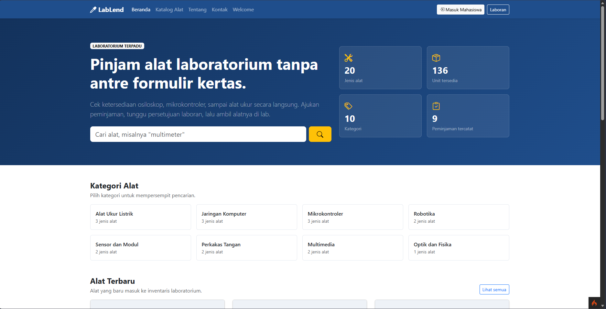

**Gambar 1.** Beranda publik LabLend. Halaman menggunakan layout Bootstrap 5 dengan partial navbar, kolom pencarian, dan kartu statistik jumlah jenis alat, unit tersedia, kategori, serta peminjaman tercatat (Poin 3).

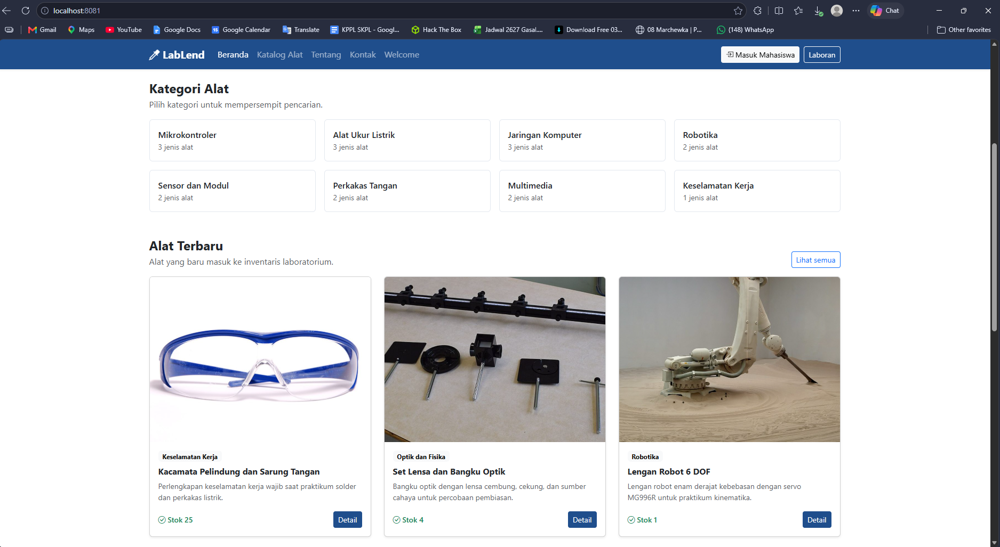

**Gambar 2.** Kategori dan alat terbaru pada beranda. Daftar kategori beserta jumlah jenis alat, diikuti kartu alat terbaru yang menampilkan foto, kategori, deskripsi singkat, dan stok (Poin 3 dan 6).

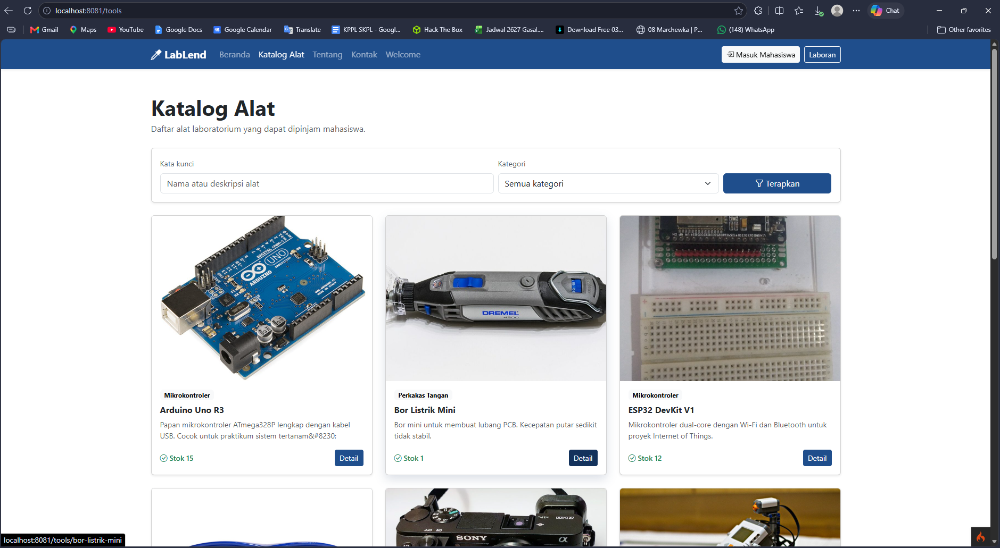

**Gambar 3.** Katalog alat. Pencarian berdasarkan kata kunci dan filter kategori. Setiap kartu menampilkan foto alat yang tersimpan di `public/uploads/tools/` (Poin 2, 3, dan 6).

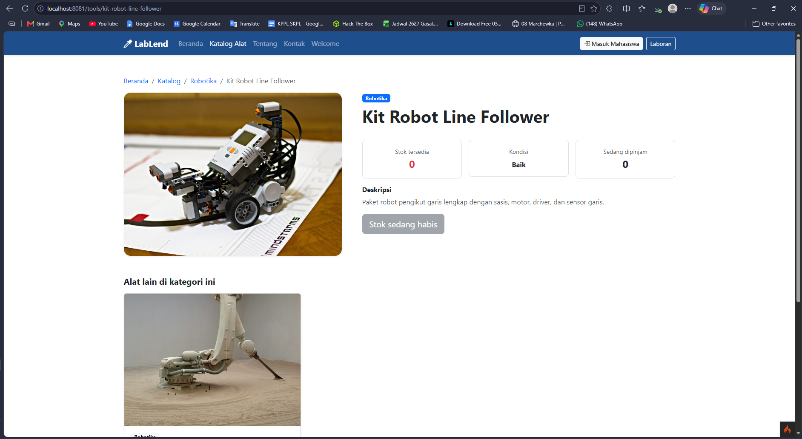

**Gambar 4.** Detail alat. Halaman detail diakses melalui slug alat. Alat dengan stok kosong menampilkan tombol nonaktif "Stok sedang habis", disertai daftar alat lain pada kategori yang sama (Poin 2 dan 5).

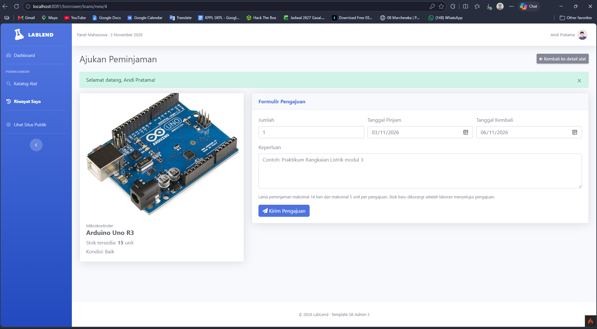

**Gambar 5.** Formulir pengajuan peminjaman. Mahasiswa yang telah login mengisi jumlah, tanggal pinjam, tanggal kembali, dan keperluan. Halaman menggunakan layout SB Admin 2 dengan sidebar versi mahasiswa (Poin 4, 5, dan 7).

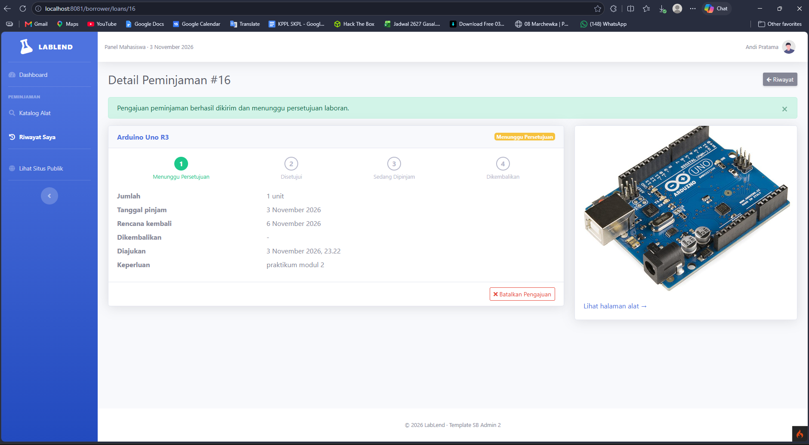

**Gambar 6.** Detail pengajuan setelah dikirim. Pesan flash keberhasilan dan detail peminjaman dengan status Menunggu Persetujuan. Pengajuan pada status ini masih dapat dibatalkan (Poin 5).

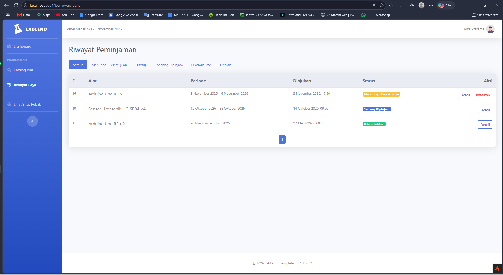

**Gambar 7.** Riwayat peminjaman mahasiswa. Daftar hanya memuat peminjaman milik akun yang sedang login, dilengkapi filter status dan pagination (Poin 5 dan 7).

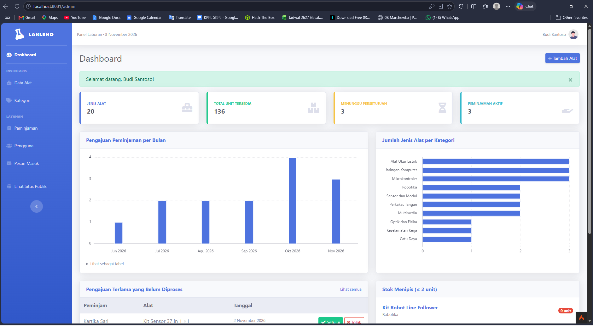

**Gambar 8.** Dashboard laboran. Kartu statistik, grafik pengajuan per bulan, dan grafik jumlah jenis alat per kategori menggunakan Chart.js. Sidebar menampilkan menu khusus laboran (Poin 4).

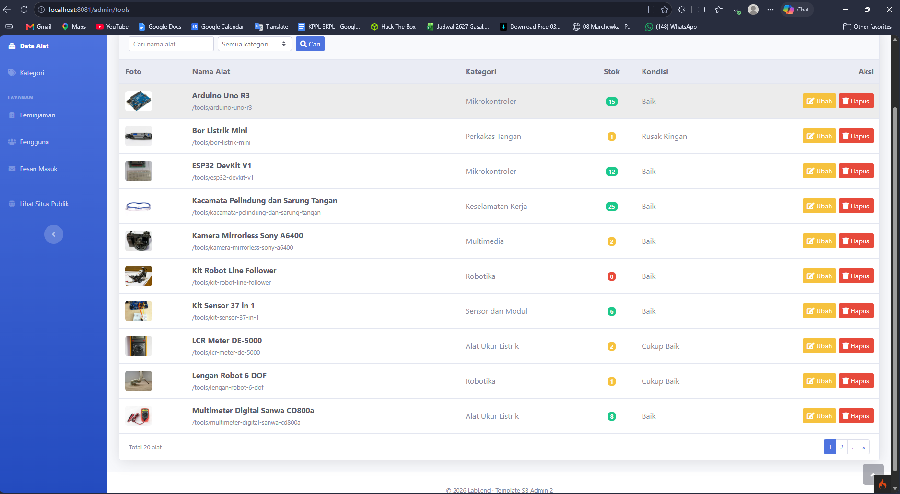

**Gambar 9.** Data alat pada panel laboran. CRUD alat dengan pencarian, filter kategori, miniatur foto, indikator stok, dan kondisi alat. Tombol Hapus dikirim melalui form POST yang memuat token CSRF (Poin 5 dan 6).

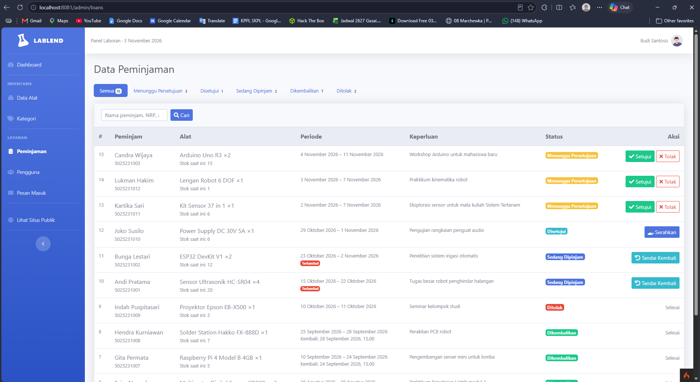

**Gambar 10.** Pengelolaan peminjaman oleh laboran. Tab status beserta jumlah data, pencarian, penanda keterlambatan, serta tombol Setujui, Tolak, Serahkan, dan Tandai Kembali yang memperbarui stok dalam satu transaksi (Poin 5 dan 7).

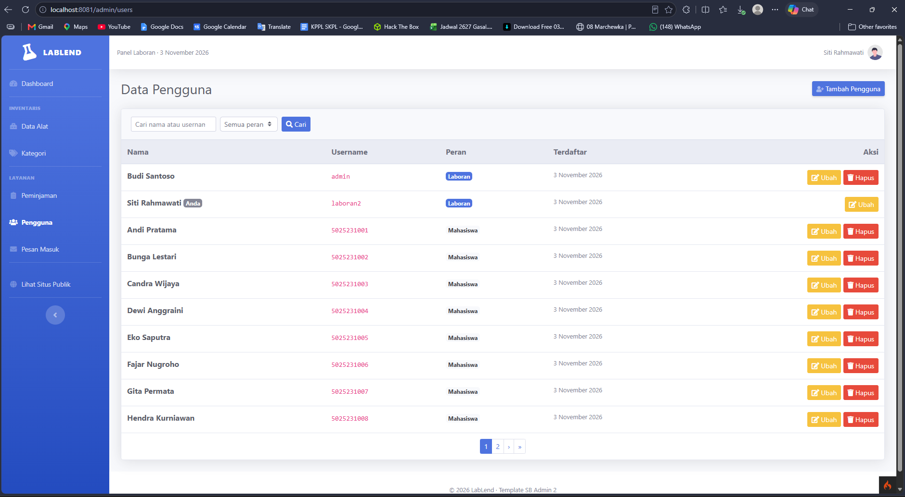

**Gambar 11.** Data pengguna. Daftar akun laboran dan mahasiswa dengan pencarian dan filter peran. Akun yang sedang login diberi penanda "Anda" dan tidak dapat dihapus oleh dirinya sendiri (Poin 7).

---

## Latihan 2a

Latihan 2a berupa Sistem Informasi Akademik (SIAKAD) dengan tiga peran, yaitu `admin`, `lecturer`, dan `student`. Seluruh peran masuk melalui `/login` dan diarahkan ke dashboard masing-masing. Seluruh halaman menggunakan template SB Admin 2.

**Akun demo** 

| Peran | Username | Password | Catatan |
|---|---|---|---|
| Admin | `admin` | `admin123` | |
| Dosen | `0012038501` | `dosen123` | Dr. Ahmad Fauzi, mengampu Teori Graf (10 peserta) dan menjadi dosen wali |
| Dosen | NIDN lain dari menu Dosen | `dosen123` | total 12 dosen |
| Mahasiswa | `5025241001` | `mahasiswa123` | semester 5, KRS semester berjalan belum diisi untuk keperluan demonstrasi |
| Mahasiswa | `5025251001` | `mahasiswa123` | semester 3, KRS sudah terisi |

Akun yang dibuat atau direset oleh admin menggunakan NIM atau NIDN sebagai password awal.

**Struktur data**

| Tabel | Isi |
|---|---|
| `users` | `name`, `username` unik (NIM, NIDN, atau `admin`), `password`, `role` |
| `study_programs` | `code` unik, `name`, `degree` (`D3` / `D4` / `S1` / `S2`) |
| `lecturers` | `user_id`, `study_program_id`, `lecturer_number` (NIDN), `email`, `phone` |
| `students` | `user_id`, `study_program_id`, `advisor_id` (dosen wali, bernilai NULL apabila dosen dihapus), `student_number` (NIM), `entry_year` |
| `courses` | `study_program_id`, `lecturer_id`, `code`, `name`, `credits`, `semester`, `quota`, `schedule`, `room` |
| `enrollments` | `student_id`, `course_id`, `academic_year` (misalnya `2026/2027`), `term` (`odd` / `even`), `score`, `grade`, `weight`, dengan kunci unik (`student_id`, `course_id`, `academic_year`) |

Seeder mengisi 10 program studi, 12 dosen, 30 mahasiswa angkatan 2024 dan 2025, 36 mata kuliah, serta 415 data KRS. Nilai semester sebelumnya dibangkitkan menggunakan `mt_srand(2026)` sehingga hasilnya selalu sama setiap kali seeder dijalankan.

Pengaturan akademik dihimpun dalam `app/Config/Academic.php`:

```php
class Academic extends BaseConfig
{
    public string $currentAcademicYear = '2026/2027';
    public string $currentTerm = 'odd';
    public bool $enrollmentOpen = true;
    public int $maxCredits = 24;

    public array $gradeScale = [
        ['min' => 86, 'grade' => 'A', 'weight' => 4.0],
        ['min' => 76, 'grade' => 'AB', 'weight' => 3.5],
        ['min' => 66, 'grade' => 'B', 'weight' => 3.0],
        ['min' => 61, 'grade' => 'BC', 'weight' => 2.5],
        ['min' => 56, 'grade' => 'C', 'weight' => 2.0],
        ['min' => 41, 'grade' => 'D', 'weight' => 1.0],
        ['min' => 0, 'grade' => 'E', 'weight' => 0.0],
    ];
}
```

### Fitur Admin

- CRUD program studi, dosen, mahasiswa, dan mata kuliah, lengkap dengan pencarian, filter program studi, dan pagination.
- Menambahkan mahasiswa sekaligus membuat akun login dalam satu transaksi, dengan username dan password awal berupa NIM. Ketentuan yang sama berlaku untuk dosen menggunakan NIDN. Perubahan NIM turut memperbarui username.
- Menetapkan dosen wali melalui formulir mahasiswa atau halaman Atur Dosen Wali, yang mendukung penetapan untuk banyak mahasiswa sekaligus serta menampilkan jumlah mahasiswa perwalian setiap dosen.
- Mereset password akun ke NIM atau NIDN.
- Penghapusan data dibatasi: program studi yang masih memiliki data, dosen yang masih mengampu mata kuliah, dan mata kuliah yang sudah tercatat di KRS tidak dapat dihapus.

### Fitur Dosen

- Melihat kelas yang diampu beserta jumlah peserta dan kuotanya.
- Mengisi nilai angka; huruf mutu dan bobot dihitung di server oleh `GradeService` serta ditampilkan langsung di browser ketika nilai diketik. Nilai pada periode sebelumnya tetap dapat dilihat.
- Melihat daftar mahasiswa perwalian beserta SKS dan IPK masing-masing, serta transkrip per semester.
- Hanya dapat mengakses kelas yang diampunya. Akses atau pengiriman nilai ke kelas dosen lain menghasilkan respons 403, dan ID KRS dari kelas lain yang disisipkan ke formulir tidak diproses.

### Fitur Mahasiswa

- Mengisi KRS dari mata kuliah program studinya yang ditawarkan pada semester berjalan. Pada semester ganjil, mata kuliah yang ditawarkan adalah mata kuliah semester 1, 3, 5, dan 7.
- Pengisian KRS divalidasi terhadap batas SKS pada konfigurasi, kuota kelas, larangan mengambil mata kuliah yang sama dua kali pada tahun akademik yang sama, kesesuaian program studi, dan kesesuaian semester.
- Membatalkan mata kuliah yang belum dinilai selama periode masih berjalan.
- Melihat KHS per semester dengan IP, riwayat IP setiap semester, dan IPK.
- Mencetak KRS dan KHS dalam format A4 menggunakan `@media print`, dilengkapi kolom tanda tangan dosen wali.

### Potongan Kode SIAKAD

Akun login dan profil mahasiswa disimpan dalam satu transaksi sehingga apabila salah satu proses gagal, keduanya dibatalkan.

```php
private function createWithAccount(Model $profiles, string $role, string $username, string $name, array $profile): int
{
    $db = db_connect();
    $db->transBegin();

    try {
        $userId = model(UserModel::class)->insert([
            'name'     => $name,
            'username' => $username,
            'password' => $username,
            'role'     => $role,
        ]);

        $profile['user_id'] = $userId;
        $profileId = $profiles->insert($profile);

        if (! $profileId) {
            throw new RuntimeException('Data profil gagal disimpan.');
        }

        $db->transCommit();
    } catch (Throwable $exception) {
        $db->transRollback();

        throw $exception;
    }

    return (int) $profileId;
}
```

`EnrollmentService::enroll()` mengunci baris mata kuliah menggunakan `SELECT ... FOR UPDATE` sebelum menghitung jumlah peserta agar kuota tidak terlampaui ketika banyak mahasiswa mendaftar secara bersamaan.

```php
$course = $db->query('SELECT * FROM courses WHERE id = ? FOR UPDATE', [$courseId])->getRowArray();

$alreadyTaken = $db->table('enrollments')
    ->where('student_id', $student['id'])
    ->where('course_id', $courseId)
    ->where('academic_year', $year)
    ->countAllResults();

if ($alreadyTaken > 0) {
    throw new RuntimeException('Mata kuliah ' . $course['name'] . ' sudah Anda ambil pada tahun akademik ' . $year . '.');
}

$credits = $this->currentCredits((int) $student['id']);

if ($credits + (int) $course['credits'] > $this->config->maxCredits) {
    throw new RuntimeException('Total SKS akan menjadi ' . ($credits + (int) $course['credits']) . ', melebihi batas ' . $this->config->maxCredits . ' SKS.');
}

$enrolled = $db->table('enrollments')
    ->where('course_id', $courseId)
    ->where('academic_year', $year)
    ->where('term', $term)
    ->countAllResults();

if ($enrolled >= (int) $course['quota']) {
    throw new RuntimeException('Kuota kelas ' . $course['name'] . ' sudah penuh (' . $course['quota'] . ' mahasiswa).');
}
```

Nilai angka dikonversi menjadi huruf mutu berdasarkan skala pada konfigurasi. IP dihitung sebagai jumlah (SKS × bobot) dibagi jumlah SKS yang telah dinilai, sedangkan IPK menggunakan rumus yang sama untuk seluruh semester.

```php
public function fromScore(float $score): array
{
    foreach ($this->config->gradeScale as $level) {
        if ($score >= $level['min']) {
            return ['grade' => $level['grade'], 'weight' => $level['weight']];
        }
    }

    return ['grade' => 'E', 'weight' => 0.0];
}

public function summarize(array $enrollments): array
{
    $totalCredits = 0;
    $gradedCredits = 0;
    $qualityPoints = 0.0;

    foreach ($enrollments as $enrollment) {
        $credits = (int) $enrollment['credits'];
        $totalCredits += $credits;

        if ($enrollment['grade'] !== null) {
            $gradedCredits += $credits;
            $qualityPoints += $credits * (float) $enrollment['weight'];
        }
    }

    return [
        'totalCredits'  => $totalCredits,
        'gradedCredits' => $gradedCredits,
        'qualityPoints' => $qualityPoints,
        'gpa'           => $gradedCredits > 0 ? round($qualityPoints / $gradedCredits, 2) : null,
    ];
}
```

Pemeriksaan bahwa dosen hanya dapat mengakses kelas yang diampunya:

```php
public function show(int $courseId): ResponseInterface|string
{
    $course = $this->findCourse($courseId);

    if (! $this->ownsCourse($course)) {
        return $this->forbidden('Anda bukan dosen pengampu mata kuliah ' . $course['name'] . '.');
    }

    return view('lecturer/classes/show', ['course' => $course]);
}
```

Aturan cetak pada `public/assets/css/print.css`:

```css
@media print {
    @page {
        size: A4;
        margin: 12mm;
    }

    .print-toolbar {
        display: none;
    }

    .sheet {
        width: auto;
        margin: 0;
        padding: 0;
        box-shadow: none;
    }
}
```

### Hasil Pengujian SIAKAD

| Percobaan | Hasil |
|---|---|
| Menambah mata kuliah hingga total menjadi 26 SKS | ditolak, batas 24 SKS |
| Mendaftar ke "Kecerdasan Buatan" (kuota 3, sudah terisi 3) | ditolak, kuota penuh |
| Mengambil mata kuliah yang sama untuk kedua kalinya, mata kuliah semester genap, atau mata kuliah prodi lain | ditolak dengan pesan yang sesuai |
| Nilai 86 / 85,99 / 76 / 61 / 55,5 / 41 / 12 | A / AB / AB / BC / D / D / E |
| IPK mahasiswa demo pada halaman KHS dibandingkan dengan perhitungan SQL langsung | keduanya bernilai 3,44 |
| Dosen mengakses kelas dosen lain atau mahasiswa perwalian dosen lain | 403 |
| Mahasiswa baru yang dibuat admin login menggunakan NIM sebagai password | berhasil |

### Dokumentasi Tampilan

Seluruh gambar pada bagian ini tersimpan di folder `docs/latihan2a/`.

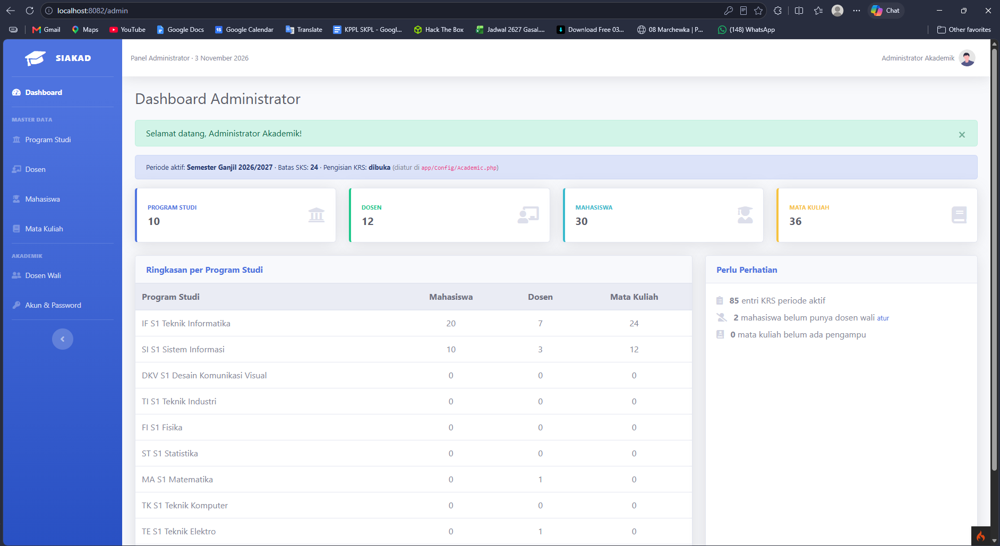

**Gambar 12.** Dashboard admin SIAKAD. Periode aktif dan batas SKS dari `Config\Academic`, jumlah data master, ringkasan per program studi, serta daftar hal yang memerlukan tindak lanjut.

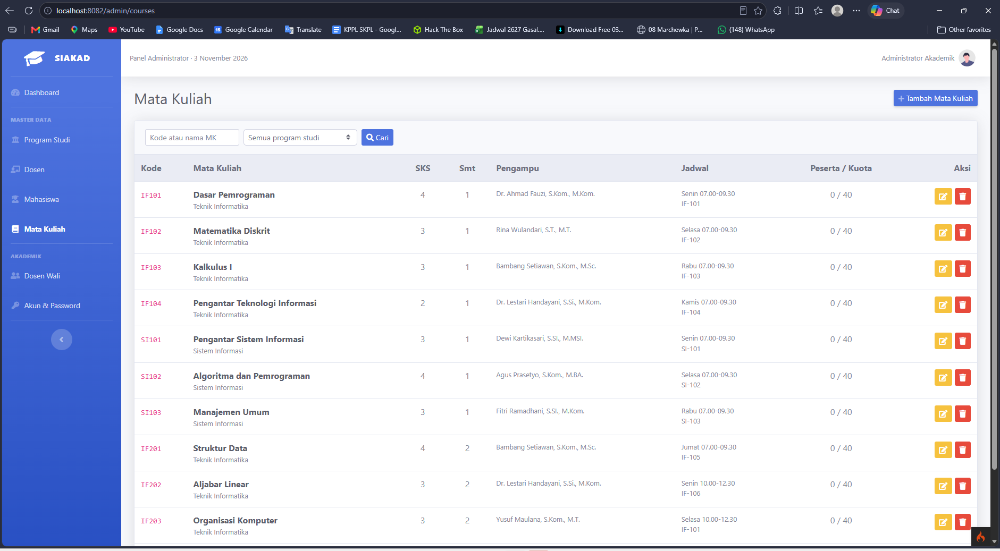

**Gambar 13.** Daftar mata kuliah. CRUD mata kuliah dengan pencarian, filter program studi, dosen pengampu, jadwal, serta jumlah peserta dibandingkan kuota pada periode aktif.

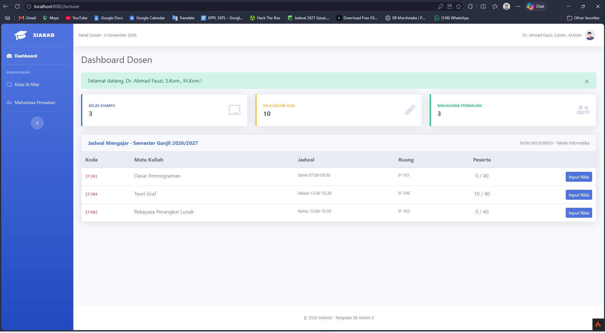

**Gambar 14.** Dashboard dosen. Jumlah kelas yang diampu, nilai yang belum diisi, jumlah mahasiswa perwalian, serta jadwal mengajar pada semester berjalan.

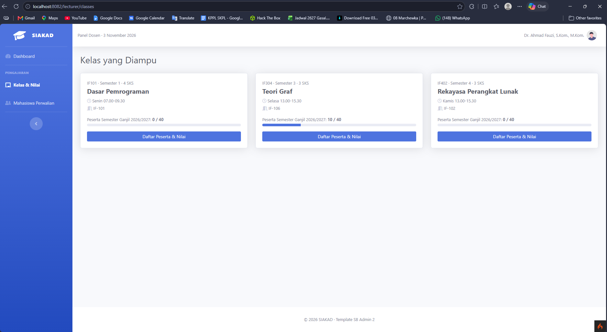

**Gambar 15.** Daftar kelas yang diampu. Halaman hanya menampilkan kelas milik dosen yang sedang login, dilengkapi indikator kuota peserta dan tautan menuju input nilai.

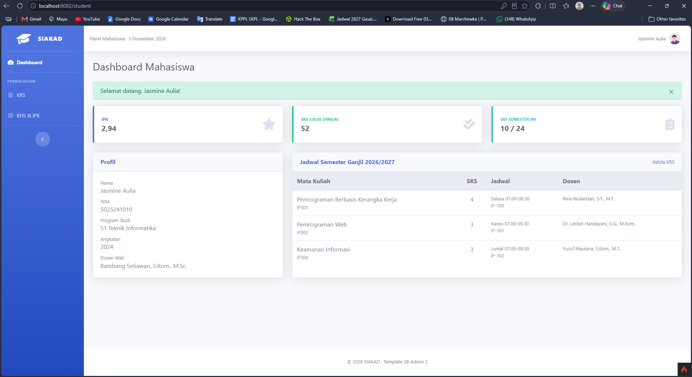

**Gambar 16.** Dashboard mahasiswa. IPK, jumlah SKS yang telah dinilai, SKS semester berjalan dibandingkan batas 24 SKS, profil beserta dosen wali, dan jadwal kuliah berdasarkan KRS.

---

## Latihan 2b

Latihan 2b berupa toko online Kopi Nusantara yang menjual biji kopi dari berbagai daerah di Indonesia. Pengunjung dapat berbelanja tanpa akun hingga tahap checkout, pembeli (`buyer`) menyelesaikan pembayaran, dan admin mengelola katalog serta pesanan.

**Akun demo** 

| Peran | Email | Password |
|---|---|---|
| Admin | `admin@kopinusantara.id` | `admin123` |
| Pembeli | `rudi@contoh.id`, `sinta@contoh.id`, `agung@contoh.id`, dan 7 akun lain | `pembeli123` |

**Struktur data**

| Tabel | Isi |
|---|---|
| `users` | `name`, `email` unik untuk login, `phone`, `address`, `password`, `role` (`admin` / `buyer`) |
| `categories` | `name`, `slug`, `description` |
| `products` | `category_id`, `name`, `slug`, `origin`, `process`, `roast_level`, `weight_gram`, `price`, `stock`, `photo`, `description`, `is_active` |
| `orders` | `user_id`, `code` (format `KN-YYYYMMDD-NNNN`), `status`, data penerima, `subtotal`, `shipping_cost`, `total`, `payment_proof`, `courier`, `tracking_number`, dan waktu tiap tahap (`paid_at`, `verified_at`, `shipped_at`, `completed_at`, `cancelled_at`) |
| `order_items` | `order_id`, `product_id` (bernilai NULL apabila produk dihapus), salinan `product_name` dan `price` saat checkout, `quantity`, `subtotal` |

Seeder mengisi 11 pengguna, 10 kategori, 24 produk, dan 15 pesanan yang mencakup seluruh status. Pesanan yang telah dibayar dilengkapi gambar bukti transfer contoh yang dibuat menggunakan GD. Setiap produk dilengkapi foto yang bersumber dari Wikimedia Commons. Berkas foto disimpan di `app/Database/Seeds/images/` dan disalin ke `public/uploads/products/` ketika seeder dijalankan, sedangkan judul, lisensi, dan tautan sumber setiap foto dicatat pada `app/Database/Seeds/images/SUMBER.txt`.

### Pengunjung dan Pembeli

- Beranda menampilkan kategori, produk terbaru, dan produk terlaris. Katalog mendukung pencarian berdasarkan nama, daerah asal, atau deskripsi, filter per kategori, pengurutan berdasarkan harga terendah, harga tertinggi, terbaru, atau nama, serta pagination. Detail produk diakses melalui slug.
- Keranjang disimpan di session sehingga pengunjung tidak perlu login untuk mulai berbelanja.
- Pengunjung yang membuka checkout tanpa login diarahkan ke halaman masuk atau daftar, kemudian dikembalikan ke halaman checkout secara otomatis dengan isi keranjang yang tetap utuh.
- Pembeli mengunggah bukti transfer berupa gambar berukuran maksimal 2 MB. Berkas disimpan di `writable/uploads/payments/`, di luar folder publik, dan hanya dapat diakses oleh pemilik pesanan atau admin.
- Pembeli dapat membatalkan pesanan yang belum dibayar (stok dikembalikan), mengonfirmasi pesanan yang telah diterima, dan melihat riwayat pesanan dengan filter status.

### Admin Toko

- Dashboard menampilkan omzet bulan ini, total omzet, pesanan yang perlu diverifikasi atau siap dikirim, grafik omzet enam bulan, jumlah pesanan per status, produk terlaris, dan produk dengan stok menipis.
- CRUD kategori dan produk, termasuk foto produk dengan pratinjau, nama berkas acak, dan penghapusan foto lama. Produk yang pernah dipesan hanya dinonaktifkan dan tidak dihapus agar riwayat pesanan tetap lengkap.
- Pengelolaan pesanan, meliputi verifikasi atau penolakan bukti transfer, pengisian kurir dan nomor resi saat pengiriman, penandaan pesanan selesai, serta pembatalan pesanan (stok dikembalikan).

### Keranjang, Ongkir, dan Checkout

Session hanya menyimpan pasangan ID produk dan jumlah; pada berkas session di server, isinya berbentuk `cart|a:1:{i:2;i:3;}`. Nama, harga, dan stok dibaca ulang dari basis data setiap kali keranjang atau checkout dibuka sehingga perubahan harga oleh admin langsung tercermin.

```php
public function items(): array
{
    $cart = $this->raw();

    if ($cart === []) {
        return [];
    }

    $products = model(ProductModel::class)
        ->withCategory()
        ->whereIn('products.id', array_keys($cart))
        ->where('products.is_active', 1)
        ->findAll();

    $items = [];

    foreach ($products as $product) {
        $quantity = (int) $cart[$product['id']];
        $items[] = [
            'product'     => $product,
            'quantity'    => $quantity,
            'price'       => (int) $product['price'],
            'subtotal'    => (int) $product['price'] * $quantity,
            'enoughStock' => $quantity <= (int) $product['stock'],
        ];
    }

    return $items;
}
```

Ongkos kirim ditetapkan sebesar Rp15.000 dan digratiskan untuk subtotal di atas Rp200.000. Kedua nilai tersebut diatur di `app/Config/Shop.php`.

```php
public function totals(array $items): array
{
    $subtotal = array_sum(array_column($items, 'subtotal'));
    $shipping = $subtotal === 0 || $subtotal > $this->config->freeShippingThreshold ? 0 : $this->config->shippingCost;

    return [
        'subtotal'     => $subtotal,
        'shipping'     => $shipping,
        'total'        => $subtotal + $shipping,
        'freeShipping' => $subtotal > $this->config->freeShippingThreshold,
    ];
}
```

Proses checkout berjalan dalam satu transaksi. Stok setiap produk dikurangi dengan syarat `stock >= qty`, kemudian nilai `affectedRows()` diperiksa. Apabila stok salah satu produk tidak mencukupi, seluruh pesanan di-rollback, termasuk pengurangan stok produk lain yang telah terjadi. Nama dan harga produk disalin ke `order_items` sehingga data pesanan lama tidak berubah ketika harga katalog berubah.

```php
$db = db_connect();
$db->transBegin();

try {
    $orderId = $this->orders->insert([
        'user_id'       => $userId,
        'code'          => $this->orders->generateCode(),
        'status'        => 'awaiting_payment',
        'subtotal'      => $totals['subtotal'],
        'shipping_cost' => $totals['shipping'],
        'total'         => $totals['total'],
    ]);

    foreach ($items as $item) {
        $product = $item['product'];

        $db->table('products')
            ->set('stock', 'stock - ' . (int) $item['quantity'], false)
            ->where('id', $product['id'])
            ->where('stock >=', (int) $item['quantity'])
            ->update();

        if ($db->affectedRows() !== 1) {
            throw new RuntimeException('Stok ' . $product['name'] . ' tidak mencukupi. Sisa stok: ' . $product['stock'] . '.');
        }

        $orderItems->insert([
            'order_id'     => $orderId,
            'product_id'   => $product['id'],
            'product_name' => $product['name'] . ' (' . $product['weight_gram'] . ' g)',
            'price'        => $item['price'],
            'quantity'     => $item['quantity'],
            'subtotal'     => $item['subtotal'],
        ]);
    }

    $db->transCommit();
} catch (Throwable $exception) {
    $db->transRollback();

    throw $exception;
}
```

### Alur Status Pesanan

Seluruh perubahan status dilakukan melalui `OrderService::move()`, yang menolak perpindahan status yang tidak tercantum dalam `OrderModel::FLOW`.

```php
public const FLOW = [
    'awaiting_payment'      => ['awaiting_verification', 'cancelled'],
    'awaiting_verification' => ['processing', 'awaiting_payment', 'cancelled'],
    'processing'            => ['shipped', 'cancelled'],
    'shipped'               => ['completed'],
    'completed'             => [],
    'cancelled'             => [],
];

public static function canMove(string $from, string $to): bool
{
    return in_array($to, self::FLOW[$from] ?? [], true);
}
```

| Status | Label di layar | Pemicu |
|---|---|---|
| `awaiting_payment` | Menunggu Pembayaran | sistem saat checkout, atau admin yang menolak bukti transfer |
| `awaiting_verification` | Menunggu Verifikasi | pembeli saat mengunggah bukti |
| `processing` | Diproses | admin setelah memverifikasi pembayaran |
| `shipped` | Dikirim | admin, wajib dengan kurir dan nomor resi |
| `completed` | Selesai | pembeli saat paket diterima, atau admin |
| `cancelled` | Dibatalkan | pembeli sebelum membayar, atau admin; stok dikembalikan |

Alur utama status pesanan adalah `awaiting_payment` → `awaiting_verification` → `processing` → `shipped` → `completed`. Penolakan bukti transfer (kembali ke `awaiting_payment`) ditambahkan agar pembeli dapat mengunggah ulang bukti yang keliru. Setiap pembaruan status disertai syarat `WHERE status = <status lama>` sehingga pesanan tidak akan diproses dua kali meskipun dua admin menekan tombol secara bersamaan.


### Dokumentasi 

Seluruh gambar pada bagian ini tersimpan di folder `docs/latihan2b/`.

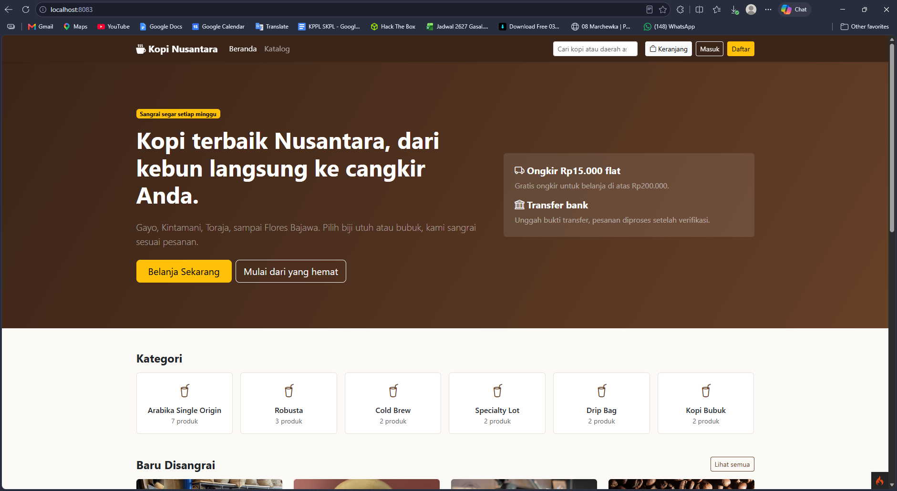

**Gambar 17.** Beranda toko. Halaman publik Bootstrap 5 yang memuat informasi ongkos kirim Rp15.000 (gratis untuk belanja di atas Rp200.000), metode pembayaran transfer bank, dan daftar kategori.

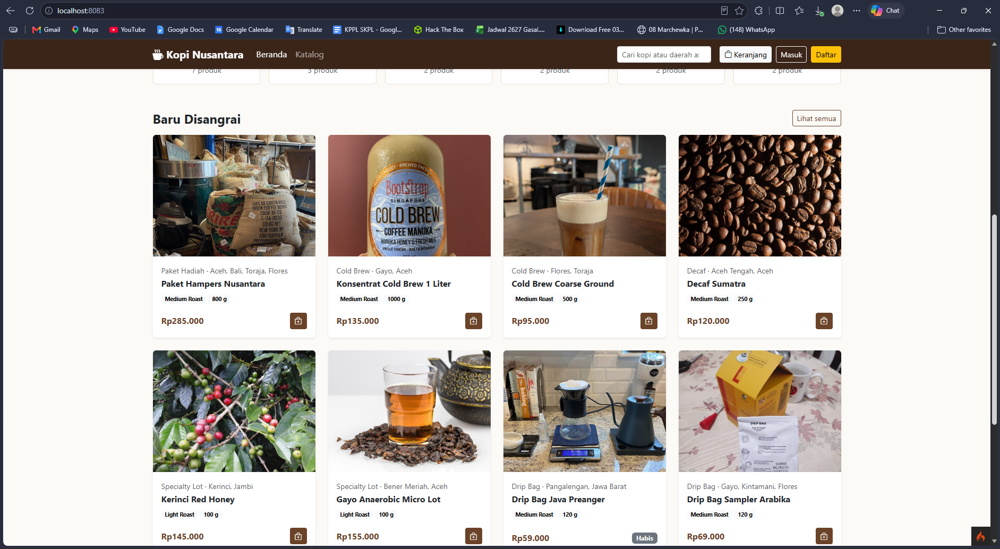

**Gambar 18.** Produk terbaru pada beranda. Bagian "Baru Disangrai" menampilkan foto, kategori, daerah asal, tingkat sangrai, berat, dan harga produk. Produk dengan stok kosong diberi label Habis.

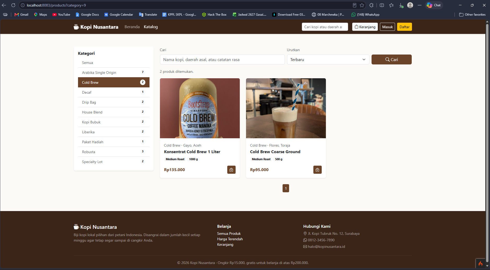

**Gambar 19.** Penyaringan katalog berdasarkan kategori. Katalog yang difilter pada kategori Cold Brew. Panel kiri menampilkan jumlah produk per kategori, sedangkan bagian atas menyediakan pencarian dan pilihan urutan.

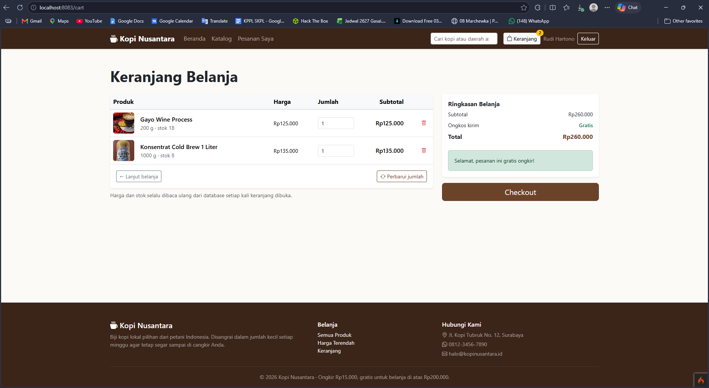

**Gambar 20.** Keranjang belanja. Session hanya menyimpan ID produk dan jumlah, sedangkan harga dan stok dibaca ulang dari basis data setiap kali keranjang dibuka. Ringkasan belanja menunjukkan bahwa pesanan memperoleh gratis ongkir.

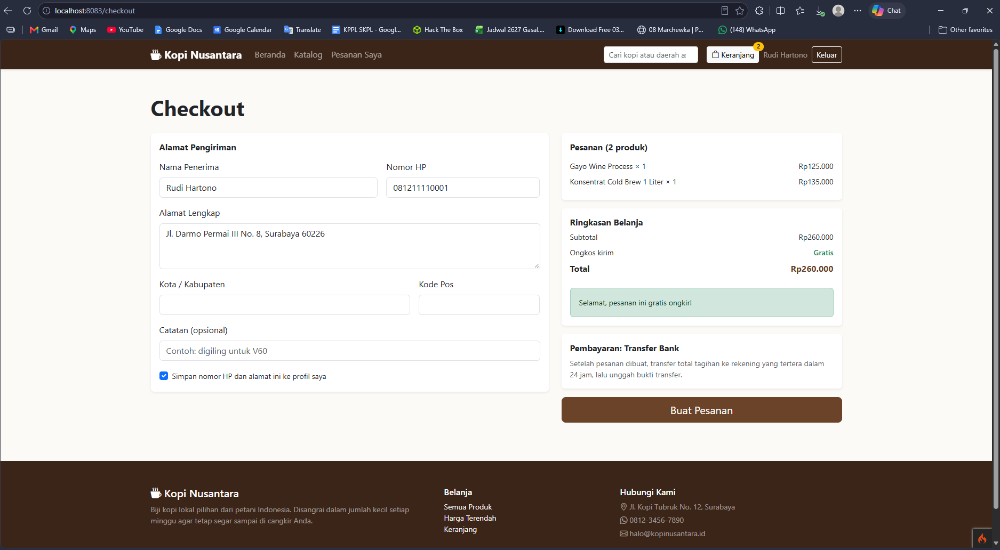

**Gambar 21.** Halaman checkout. Formulir alamat pengiriman yang terisi otomatis dari profil pembeli, ringkasan pesanan, dan informasi pembayaran melalui transfer bank.

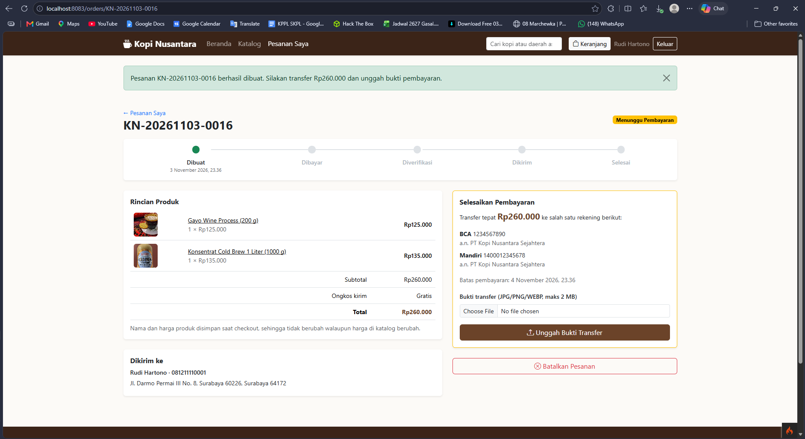

**Gambar 22.** Pesanan berhasil dibuat. Pesanan berstatus Menunggu Pembayaran beserta rincian produk, total tagihan, nomor rekening tujuan, formulir unggah bukti transfer, dan tombol pembatalan.

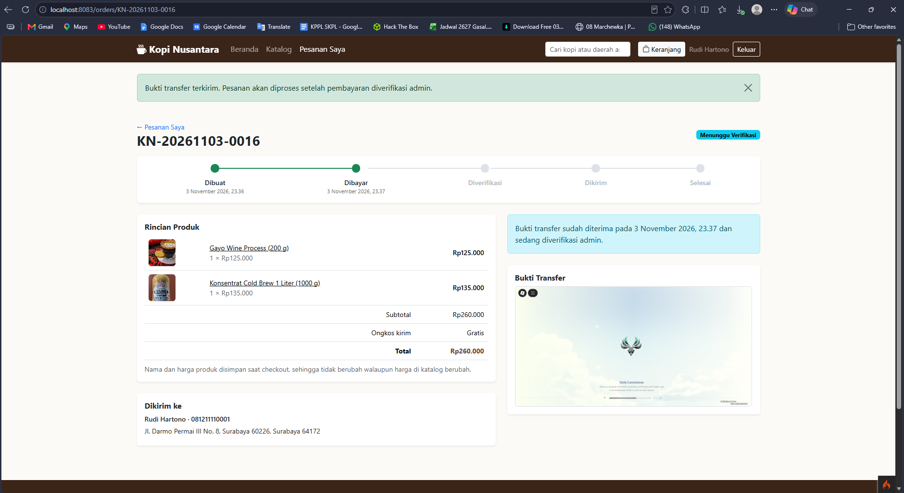

**Gambar 23.** Bukti transfer telah diunggah. Status pesanan berubah menjadi Menunggu Verifikasi. Gambar bukti transfer ditampilkan melalui controller yang memeriksa kepemilikan pesanan.

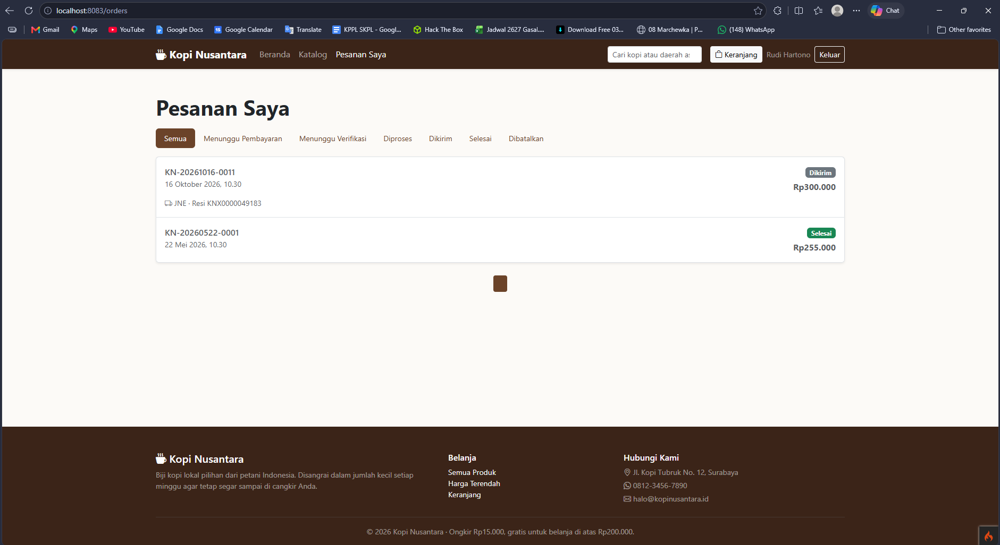

**Gambar 24.** Halaman Pesanan Saya. Riwayat pesanan pembeli dengan filter status. Pesanan yang sedang dikirim menampilkan nama kurir dan nomor resi.

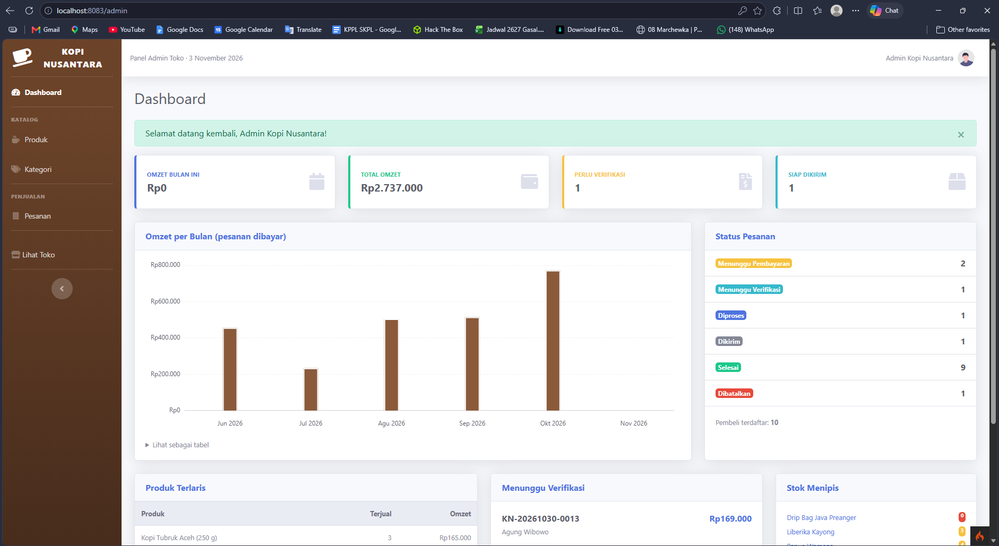

**Gambar 25.** Dashboard admin toko. Omzet bulan berjalan, total omzet, pesanan yang perlu diverifikasi atau siap dikirim, grafik omzet per bulan, jumlah pesanan per status, produk terlaris, dan stok yang menipis.

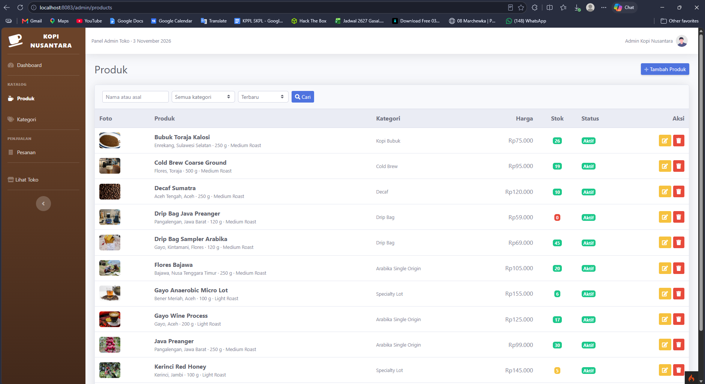

**Gambar 26.** Data produk pada panel admin. CRUD produk dengan pencarian, filter kategori, pengurutan, miniatur foto, harga, indikator stok, dan status aktif.

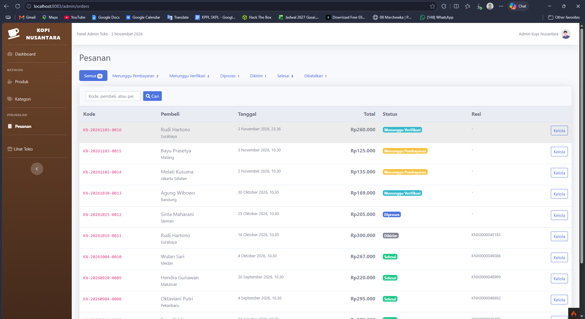

**Gambar 27.** Pengelolaan pesanan. Daftar pesanan dengan tab status, pencarian, total tagihan, dan nomor resi. Tombol Kelola membuka halaman detail pesanan.

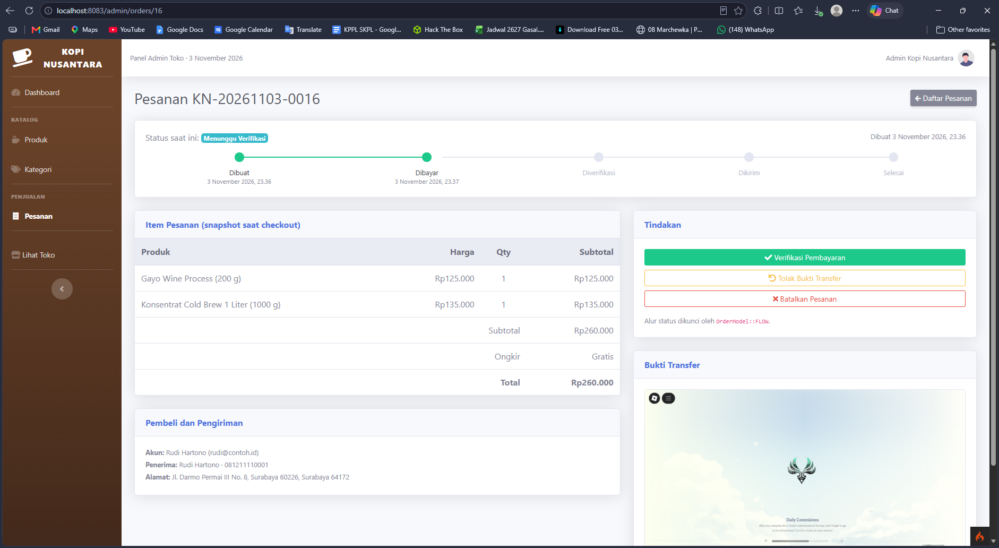

**Gambar 28.** Verifikasi pembayaran oleh admin. Detail pesanan berstatus Menunggu Verifikasi dengan item hasil snapshot saat checkout, data pengiriman, dan bukti transfer. Admin dapat memverifikasi, menolak bukti, atau membatalkan pesanan.

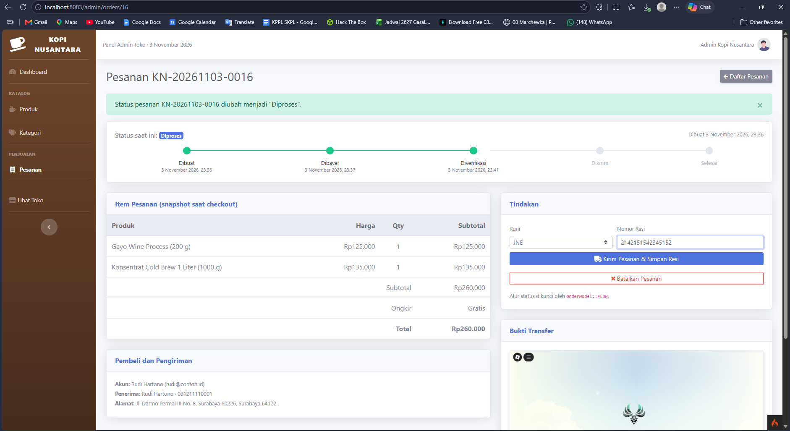

**Gambar 29.** Pengisian kurir dan nomor resi. Setelah pembayaran diverifikasi, status berubah menjadi Diproses dan admin mengisi kurir serta nomor resi untuk mengirim pesanan.

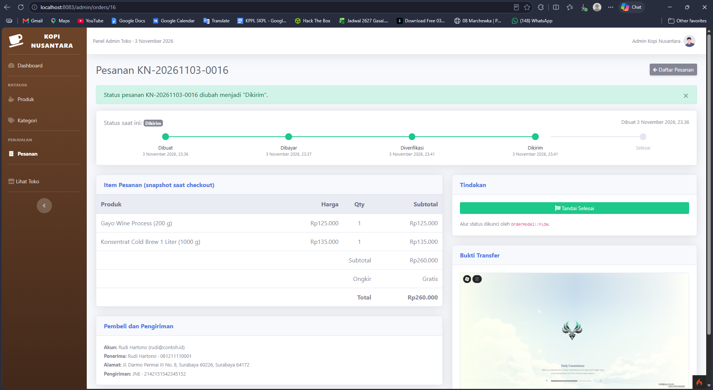

**Gambar 30.** Pesanan dalam pengiriman. Status berubah menjadi Dikirim dan data kurir beserta nomor resi tercatat pada pesanan. Tindakan yang tersisa hanya Tandai Selesai sesuai alur `OrderModel::FLOW`.
